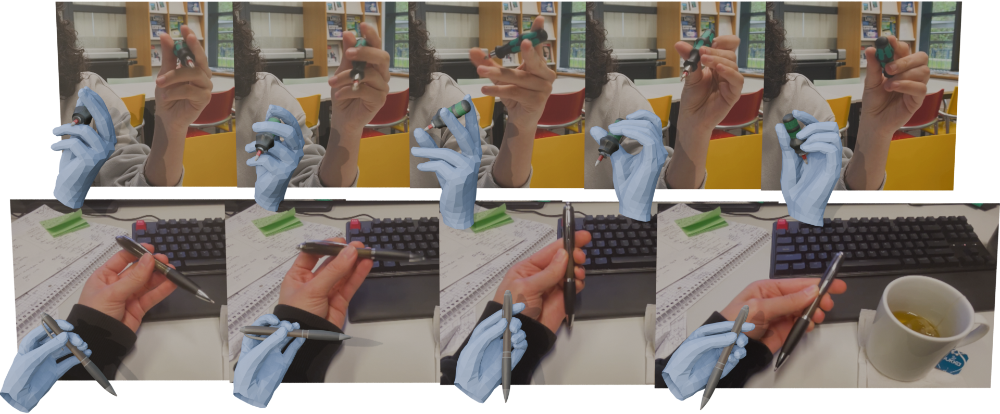

<h1 align="center">Grasp in Gaussians</h1>
<h3 align="center">Fast Monocular Reconstruction of Dynamic Hand–Object Interactions</h3>
<h5 align="center">SIGGRAPH Asia 2026 Conference Track</h5>
<p align="center">
Ayce Idil Aytekin, Xu Chen, Zhengyang Shen, Thabo Beeler, Helge Rhodin, Rishabh Dabral, Christian Theobalt
</p>


<p align="center">
<a href='https://aidilayce.github.io/GraG-page/'></a>
<a href='https://arxiv.org/abs/2604.12929'></a>
</p>

<p align="center">
  
</p>

GraG reconstructs a hand and the object it manipulates from a single monocular
video. The object is reconstructed once from a few keyframes with a
video-adapted SAM3D, the hand is initialized with Dyn-HaMR, and both are then
tracked with a compact Sum-of-Gaussians (SoG) objective. A 100-frame video takes
about 16 minutes on one RTX 4090.

## Contents

- [Installation](#installation)
- [Quick start](#quick-start)
- [Pipeline](#pipeline)
- [Evaluation](#evaluation)
- [Citation](#citation)

## Installation

GraG uses Python 3.12, CUDA 12.1 and PyTorch 2.4.1 in a
[uv](https://docs.astral.sh/uv/) environment. It runs on one 24 GB GPU.

```bash
git clone https://github.com/aidilayce/GraG.git && cd GraG
uv venv --python 3.12 .venv
source .venv/bin/activate
uv sync --extra eval
```

Then build the CUDA extensions (PyTorch3D, gsplat, nvdiffrast, chumpy, kaolin)
as described in [INSTALL.md](INSTALL.md).

### Models

Download the following checkpoints as they are under their own licenses and put them in the written location:

| Model | Location |
| --- | --- |
| [SAM 3D Objects](https://github.com/facebookresearch/sam-3d-objects) checkpoints | `third_party/SAM3DO/checkpoints/hf/` |
| [Dyn-HaMR](https://github.com/ZhengdiYu/Dyn-HaMR) data (HaMeR, ViTPose, HMP, BMC) | `third_party/Dyn_HaMR/_DATA/` |
| [MANO](https://mano.is.tue.mpg.de) (`MANO_RIGHT.pkl`, `MANO_LEFT.pkl`) | `third_party/Dyn_HaMR/_DATA/mano/` |

SAM 3, Depth Anything 3 and GLM-4.1V are downloaded from Hugging Face on first
use. Request access to [facebook/sam3](https://huggingface.co/facebook/sam3)
and run `huggingface-cli login`. Per-frame contact flags are predicted with
Gemini if `GEMINI_API_KEY` is set; otherwise contact is taken from hand/object
mask proximity.
Note that for our reported results in the paper, we used Gemini to get contact flags.

## Quick start

```bash
bash recon.sh path/to/video.mp4
```

The video is preprocessed into `data/<video>/` and the reconstruction is written
to `outputs/<video>/<timestamp>/`:

- `refiner_final_state.pt`: hand (MANO) and object trajectories and the
  canonical object mesh, in the camera frame.
- `videos/<video>_final_mesh.mp4`, `videos/<video>_final_mesh_side.mp4`: the
  reconstruction overlaid on the input and seen from the side.

`GRAG_WORK_DIR` and `GRAG_LOG_ROOT` change the data and output folders.

## Pipeline

`recon.sh` runs two steps that can also be called separately.

**Preprocessing, Stage 1 and Stage 2**

```bash
python preprocessing/preprocess.py --video_path path/to/video.mp4
```

Every step is cached in
the scene folder, so an interrupted run resumes where it stopped.
`--video_path` also accepts a folder of frames called `rgb/`.

**Stage 3: hand–object tracking**

```bash
python optimization/opt.py --exp <video>
```

| Argument | Default | Meaning |
| --- | --- | --- |
| `--window_size` | 8 | frames per window |
| `--window_stride` | 7 | stride between windows (one frame overlap) |
| `--iters_per_window` | 100 | AdamW steps per window |
| `--demo_root` | `GRAG_WORK_DIR` | folder that holds `<video>/` |
| `--logdir` | `GRAG_LOG_ROOT` | output folder |
| `--skip_final_render` | off | do not render the result videos |

To render a saved result again:

```bash
python scripts/render_mesh_overlays.py --seq_name <video> \
    --checkpoint outputs/<video>/<run>/refiner_final_state.pt \
    --demo_root data --out_dir outputs/<video>/<run>/videos
```


## Evaluation

We evaluate on the 18 HO3D v3 sequences used by
[HOLD](https://github.com/zc-alexfan/hold) and the 18 HOT3D clips listed in
`eval/hot3d/clips_table.csv`, with HOLD's metrics. Ground truth is prepared
once with HOLD (HO3D) and the HOT3D toolkit (HOT3D); see
[eval/README.md](eval/README.md). The evaluator runs in HOLD's environment.

For one sequence, reconstruct and evaluate in one call:

```bash
export MANO_DIR=third_party/Dyn_HaMR/_DATA/mano
export HOLD_CODE_DIR=/path/to/hold/code          # HO3D ground truth
export HOT3D_GT_CACHE_DIR=/path/to/hot3d_gt      # HOT3D ground truth
export HOLD_PYTHON=/path/to/hold_env/bin/python
bash recon.sh path/to/hold_ABF12_ho3d/rgb ho3d --eval
```

For many sequences, list `dataset,sequence,checkpoint` per line in a runs file
and call `eval/run_eval.py`
([eval/README.md](eval/README.md#batch-runs)), then `eval/summarize.py` for the
dataset means.

## Citation

```bibtex
@inproceedings{aytekin2026grasp,
author = {Aytekin, Ayce Idil and Chen, Xu and Shen, Zhengyang and Beeler, Thabo and Rhodin, Helge and Dabral, Rishabh and Theobalt, Christian},
title = {Grasp in Gaussians: Fast Monocular Reconstruction of Dynamic Hand--Object Interactions},
year = {2026},
publisher = {Association for Computing Machinery},
address = {New York, NY, USA},
url = {https://doi.org/10.1145/3829340.3842273},
doi = {10.1145/3829340.3842273},
booktitle = {Proceedings of the SIGGRAPH Asia 2026 Conference Papers},
numpages = {11},
location = {Kuala Lumpur, Malaysia},
series = {SA Conference Papers '26}
}
```

## Acknowledgements

GraG is under MIT license. However, we build on
[SAM 3](https://github.com/facebookresearch/sam3),
[SAM 3D Objects](https://github.com/facebookresearch/sam-3d-objects),
[MV-SAM3D](https://github.com/devinli123/MV-SAM3D),
[Depth Anything 3](https://github.com/ByteDance-Seed/Depth-Anything-3),
[GLM-4.1V-Thinking](https://github.com/zai-org/GLM-V),
[Gemini](https://ai.google.dev/gemini-api),
[Dyn-HaMR](https://github.com/ZhengdiYu/Dyn-HaMR) with
[HaMeR](https://github.com/geopavlakos/hamer),
[ViTPose](https://github.com/ViTAE-Transformer/ViTPose),
[DROID-SLAM](https://github.com/princeton-vl/DROID-SLAM),
[HMP](https://hmp.is.tue.mpg.de) and
[Hand-BMC](https://github.com/MengHao666/Hand-BMC-pytorch),
[MANO](https://mano.is.tue.mpg.de),
[PyTorch3D](https://github.com/facebookresearch/pytorch3d),
[gsplat](https://github.com/nerfstudio-project/gsplat),
[nvdiffrast](https://github.com/NVlabs/nvdiffrast) and
[Kaolin](https://github.com/NVIDIAGameWorks/kaolin).
Evaluation follows [HOLD](https://github.com/zc-alexfan/hold) on
[HO3D v3](https://github.com/shreyashampali/ho3d) and uses the
[HOT3D](https://github.com/facebookresearch/hot3d) toolkit. Each component is under their own license.
