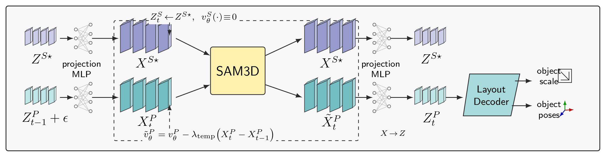

# Video-Adapted SAM3D Pose/Shape Flow

This note summarizes the video-specific path in this fork of SAM3DO. The main
change is temporal warm-starting of pose/layout tokens while reusing or
constraining shape tokens across frames.

## High-Level Diagram



The rendered figure is generated from `video_adapted_sam3d_flow_tikz.tex`.
The compiled vector version is `video_adapted_sam3d_flow_tikz.pdf`.

## What Is Warm-Started?

The video loop stores the previous frame's generated layout tokens:

- `6drotation_normalized`
- `translation`
- `scale`
- `translation_scale`

For the next frame, `sample_sparse_structure(..., use_prev_pose=True,
prev_pose_dict=...)` sets those tensors on the sparse-structure flow backbone.
The sampler first creates normal random `x_0` for every latent stream. Then
`warm_start_layout()` replaces only the layout keys with:

```python
x0[k] = prev + torch.randn_like(prev)
```

So the noise is added in the original low-dimensional layout-token space, before
the per-modality `Latent.to_input()` adapters project anything to 1024 channels.
It is not added after the high-dimensional MLP projection.

## Where The MLPs Sit

Each modality has a `Latent` adapter:

- `input_layer`: original channel count -> `model_channels` (`1024`)
- positional embedding is added after the input projection
- `out_layer`: `1024` -> original channel count

The configured streams are:

- `6drotation_normalized`: `1 x 6 -> 1 x 1024 -> 1 x 6`
- `translation`: `1 x 3 -> 1 x 1024 -> 1 x 3`
- `scale`: `1 x 3 -> 1 x 1024 -> 1 x 3`
- `translation_scale`: `1 x 1 -> 1 x 1024 -> 1 x 1`
- `shape`: `4096 x 8 -> 4096 x 1024 -> 4096 x 8`

The four pose/layout streams are merged into one 4-token layout stream for the
transformer, then split again before the output adapters. Shape remains its own
large token stream.

## Is The Pose A Latent?

It is a latent in the flow-model sense: the sampler denoises/integrates these
tensors exactly like the shape latent, and the transformer predicts velocities
for them.

It is not an opaque learned shape-style latent. The layout tensors have direct
semantic names and low dimensionality: normalized 6D rotation, translation
direction, log scale, and log translation scale. The final pose decoder mostly
performs deterministic geometry:

1. map generated keys to pose-target fields
2. denormalize the 6D rotation stats, then orthonormalize to a rotation matrix
3. convert rotation matrix to quaternion
4. exponentiate predicted scale and translation-scale fields
5. apply the pose-target convention and pointmap scene scale/shift
6. return camera-space object translation, rotation, and scale

So "pose latent" is accurate as shorthand for "pose/layout variables inside the
diffusion/flow state", but it is more structured than a generic hidden latent.

## Code Pointers

- `sam3d_objects/pipeline/video_inference_pipeline.py`: per-frame loop stores
  `prev_pose_dict_latents`, calls `sample_sparse_structure`, then decodes pose.
- `sam3d_objects/pipeline/inference_pipeline.py`: resets and enables
  `backbone.use_prev_pose` / `backbone.prev_pose_latents`.
- `sam3d_objects/model/backbone/generator/shortcut/model.py`: creates `x_0`
  noise, then calls `warm_start_layout()` before sampling.
- `sam3d_objects/model/backbone/tdfy_dit/models/mot_sparse_structure_flow.py`:
  warm start, input projection, transformer call, output projection, and optional
  temporal guidance.
- `sam3d_objects/model/backbone/tdfy_dit/models/mm_latent.py`: per-modality
  input/output MLP adapters.
- `sam3d_objects/pipeline/inference_utils.py`: pose decoder from generated
  layout fields to camera-space pose.
- `checkpoints/hf/ss_generator.yaml`: stream dimensions, 1024-channel model,
  24 transformer blocks, and layout-stream sharing.
